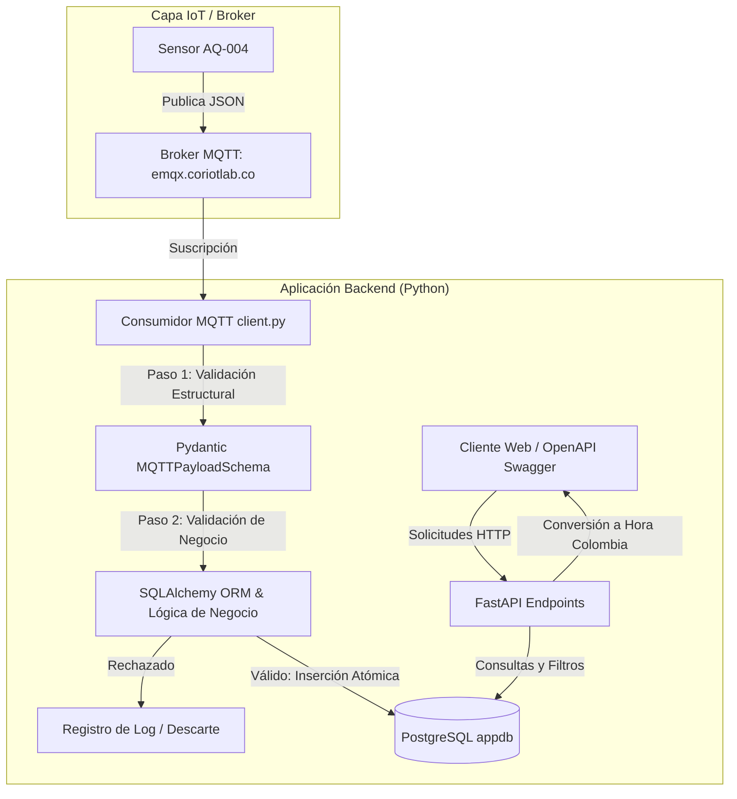
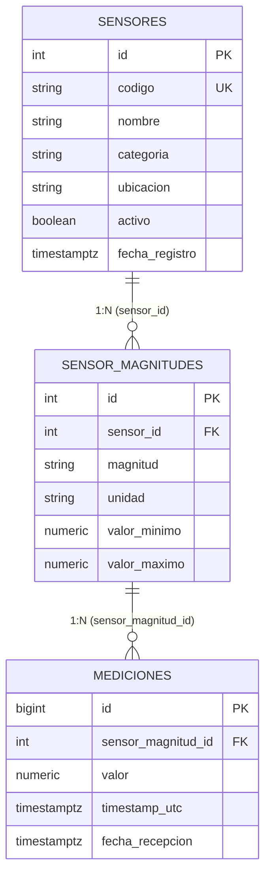

# Taller 2 — API para Adquisición, Validación y Consulta de Datos IoT con FastAPI, MQTT y PostgreSQL

---

## 1. Información General

- **Proyecto:** API para Adquisición, Validación y Consulta de Telemetría IoT
- **Asignatura:** Aplicaciones y Servicios Web
- **Programa:** Tecnología en Desarrollo de Software
- **Docente:** Juan Carlos Morales Guerra
- **Fecha de Entrega:** Octubre 2026
- **Sensor Asignado:** `AQ-004` (Calidad de aire en aulas)
- **Ubicación:** Edificio B - aula 101
- **Categoría:** `AIRE`
- **Tópico MQTT Utilizado:** `iot/sensors/AQ-004/data`
- **Broker MQTT:** `emqx.coriotlab.co:1883`

---

## 2. Descripción del Sistema

### Problema Resuelto

En entornos de monitoreo IoT, los sensores transmiten continuamente mediciones ambientales a través de redes de mensajería asíncrona. Sin embargo, los dispositivos pueden emitir datos corruptos, payloads con tipos incorrectos, magnitudes no calibradas, unidades erróneas o valores fuera de rango físico.

El sistema desarrollado resuelve este desafío implementando una arquitectura de backend desacoplada y robusta que:
1. **Consume telemetría en tiempo real** mediante el protocolo MQTT desde el tópico asignado.
2. **Valida la estructura y tipado estricto** en primera instancia con modelos Pydantic.
3. **Verifica las reglas de negocio e integridad referencial** contra la base de datos relacional PostgreSQL mediante SQLAlchemy ORM (existencia y estado activo del sensor, pertenencia de magnitudes, correspondencia de unidades y rangos numéricos válidos).
4. **Garantiza la atomicidad**: Si un payload contiene múltiples magnitudes y una sola de ellas falla, todo el mensaje es rechazado sin almacenar datos parciales.
5. **Persiste mediciones válidas** conservando el timestamp en formato UTC.
6. **Expone una API REST con FastAPI** para consultar información de sensores, catálogo de magnitudes, histórico de mediciones filtradas por rango temporal o magnitud, y la última medición registrada, convirtiendo automáticamente los timestamps a la hora local de Colombia (`America/Bogota`, UTC-5).

### Arquitectura del Sistema



### Magnitudes y Unidades Recibidas (Sensor AQ-004)

El sensor `AQ-004` (ID 31 en la base de datos) monitorea tres variables de calidad de aire interior:

| Magnitud | Unidad | Rango Mínimo | Rango Máximo | Descripción |
|---|---|---|---|---|
| `co2` | `ppm` | 300.0000 | 5000.0000 | Concentración de Dióxido de Carbono |
| `temperature` | `C` | -10.0000 | 60.0000 | Temperatura ambiental |
| `humidity` | `%` | 0.0000 | 100.0000 | Humedad relativa |

### Payload Real Recibido del Sensor

```json
{
  "sensor_id": "AQ-004",
  "timestamp": "2026-10-09T22:54:40Z",
  "measurements": {
    "co2": {
      "value": 856.08,
      "unit": "ppm"
    },
    "temperature": {
      "value": 28.41,
      "unit": "C"
    },
    "humidity": {
      "value": 47.89,
      "unit": "%"
    }
  }
}
```

---

## 3. Configuración del Entorno

### Requisitos Previos

- Python 3.10 o superior (compatible con Python 3.9+).
- Acceso a internet para conectar con el broker MQTT y la base de datos PostgreSQL.

### Instalación Paso a Paso

1. **Crear y activar el entorno virtual:**
```bash
python3 -m venv venv
source venv/bin/activate   # En Linux/macOS
# venv\Scripts\activate    # En Windows
```

2. **Instalar dependencias:**
```bash
pip install -r requirements.txt
```

3. **Configurar variables de entorno:**
Copiar la plantilla `.env.example` y crear el archivo local `.env`:
```bash
cp .env.example .env
```

Contenido representativo de `.env` (sin datos sensibles expuestos en el repositorio):
```ini
# PostgreSQL
POSTGRES_HOST=190.248.28.132
POSTGRES_PORT=3002
POSTGRES_DB=appdb
POSTGRES_USER=postgres
POSTGRES_PASSWORD=********

# MQTT
MQTT_BROKER=emqx.coriotlab.co
MQTT_PORT=1883
MQTT_TOPIC=iot/sensors/AQ-004/data
MQTT_USERNAME=
MQTT_PASSWORD=
MQTT_KEEPALIVE=60
SENSOR_CODE=AQ-004
MQTT_AUTO_START=false
```

4. **Ejecutar la API REST con FastAPI:**
```bash
uvicorn main:app --reload --host 0.0.0.0 --port 8000
```
Documentación interactiva disponible en: `http://localhost:8000/docs`

5. **Ejecutar el Consumidor MQTT:**
```bash
python mqtt/client.py
```

---

## 4. Base de Datos y Modelo Relacional

La persistencia se realiza en PostgreSQL (`appdb`), esquema `public`, utilizando un pool de conexiones administrado por SQLAlchemy.

### Tablas y Relaciones



### Integridad Referencial

- `sensores` $\rightarrow$ `sensor_magnitudes`: Clave foránea `sensor_id` con `ON UPDATE CASCADE ON DELETE RESTRICT`.
- `sensor_magnitudes` $\rightarrow$ `mediciones`: Clave foránea `sensor_magnitud_id` con `ON UPDATE CASCADE ON DELETE RESTRICT`.
- Los datos de configuración de sensores y magnitudes son de solo lectura para la aplicación; la aplicación solo realiza operaciones `INSERT` sobre `mediciones`.

---

## 5. Organización del Código

El proyecto adopta el principio de separación de responsabilidades:

```text
apps_services_2/
├── main.py                  # Punto de entrada de FastAPI, lifespan y registro de routers
├── database/
│   ├── __init__.py
│   └── connection.py        # Configuración del Engine, SessionLocal y get_db()
├── models/                  # Modelos ORM (SQLAlchemy)
│   ├── __init__.py
│   ├── sensor.py            # Mapeo de la tabla sensores
│   ├── sensor_magnitud.py   # Mapeo de la tabla sensor_magnitudes
│   └── medicion.py          # Mapeo de la tabla mediciones
├── schemas/                 # Esquemas de validación y serialización (Pydantic)
│   ├── __init__.py
│   ├── sensor.py            # DTOs para Sensores
│   ├── sensor_magnitud.py   # DTOs para Magnitudes
│   └── medicion.py          # DTOs para Mediciones y validación de Payloads MQTT
├── crud/                    # Operaciones de persistencia y consultas a BD
│   ├── __init__.py
│   ├── sensor.py            # Consultas de sensores por ID y código
│   ├── sensor_magnitud.py   # Consultas de magnitudes por sensor
│   └── medicion.py          # Consultas históricas, última medición e inserción masiva
├── api/                     # Capa de presentación y endpoints HTTP (FastAPI)
│   ├── __init__.py
│   ├── sensor.py            # Endpoints /sensores
│   ├── sensor_magnitud.py   # Endpoints /sensor-magnitudes
│   └── medicion.py          # Endpoints /mediciones
├── mqtt/                    # Integración y lógica de adquisición MQTT
│   ├── __init__.py
│   └── client.py            # Suscripción, validación multinivel y persistencia
├── tests/
│   └── test_taller2.py      # Suite de pruebas automatizadas (Pytest)
├── evidencias/
│   └── informe_evidencias.md # Registro detallado de las 18 pruebas
├── data-model.md            # Especificación técnica del modelo de datos
├── requirements.txt         # Dependencias del proyecto
└── .env.example             # Plantilla de variables de entorno
```

---

## 6. Endpoints Implementados

| Método | Ruta | Descripción | Parámetros / Filtros | Códigos HTTP |
|---|---|---|---|---|
| `GET` | `/` | Información general de la API | Ninguno | `200` |
| `GET` | `/health/db` | Verificación de conexión con PostgreSQL | Ninguno | `200` |
| `GET` | `/sensores` | Listar todos los sensores registrados | `skip`, `limit` | `200` |
| `GET` | `/sensores/{id}` | Consultar un sensor por ID | `id` (int) | `200`, `404`, `422` |
| `GET` | `/sensores/por-codigo/{codigo}` | Consultar sensor por código único (ej. `AQ-004`) | `codigo` (str) | `200`, `404` |
| `GET` | `/sensores/{id}/magnitudes` | Listar magnitudes configuradas para un sensor | `id` (int) | `200`, `404`, `422` |
| `GET` | `/sensor-magnitudes/{id}` | Consultar detalle de configuración de una magnitud | `id` (int) | `200`, `404`, `422` |
| `GET` | `/mediciones/{id}` | Consultar una medición por su identificador | `id` (int) | `200`, `404`, `422` |
| `GET` | `/sensores/{id}/mediciones` | Consulta histórica de mediciones con filtros | `id`, `desde`, `hasta`, `magnitud`, `limit` | `200`, `400`, `404`, `422` |
| `GET` | `/sensores/{id}/ultima-medicion` | Consultar la medición más reciente de un sensor | `id`, `magnitud` | `200`, `404`, `422` |

---

## 7. Evidencias de Funcionamiento

Se ejecutó la suite completa de pruebas obligatorias (`tests/test_taller2.py` y `generar_evidencias.py`), validando el 100% de los requisitos del taller.

| # | Prueba Obligatoria | Entrada | Código HTTP | Resultado y Estado | Archivo y Función |
|---|---|---|---|---|---|
| **1** | **Recepción MQTT** | Payload JSON recibido en `iot/sensors/AQ-004/data` | N/A (MQTT) | Decodificado y validado estructuralmente | `mqtt/client.py` $\rightarrow$ `on_message()`, `validar_y_procesar_payload()` |
| **2** | **Medición válida** | Mediciones `co2`, `temperature`, `humidity` válidas | N/A (PostgreSQL) | Almacenado exitosamente en `mediciones` | `mqtt/client.py`, `crud/medicion.py` $\rightarrow$ `create_mediciones_bulk()` |
| **3** | **Sensor inexistente** | Payload con `sensor_id`: `SENSOR-INEXISTENTE-999` | N/A (MQTT) | Rechazado sin almacenar | `mqtt/client.py` $\rightarrow$ `validar_y_procesar_payload()` |
| **4** | **Unidad incorrecta** | Temperatura con unidad `'F'` en vez de `'C'` | N/A (MQTT) | Rechazado sin almacenar | `mqtt/client.py` $\rightarrow$ `validar_y_procesar_payload()` |
| **5** | **Tipo de dato incorrecto** | `value`: `"NO_NUMERICO"` | N/A (Pydantic) | Rechazado por validación de tipo | `schemas/medicion.py` $\rightarrow$ `MQTTMeasurementDetail` |
| **6** | **Magnitud incorrecta** | Magnitud `radiacion_gamma` (no asociada a AQ-004) | N/A (MQTT) | Rechazado sin almacenar | `mqtt/client.py` $\rightarrow$ `validar_y_procesar_payload()` |
| **7** | **Timestamp inválido** | `timestamp`: `"FECHA_INVALIDA_2026"` | N/A (Pydantic) | Rechazado por validación ISO 8601 | `schemas/medicion.py` $\rightarrow$ `MQTTPayloadSchema` |
| **8** | **Consulta por ID existente** | `GET /sensores/31` | `200 OK` | Retorna datos del sensor `AQ-004` | `api/sensor.py` $\rightarrow$ `consultar_sensor_por_id()` |
| **9** | **Consulta por ID inexistente** | `GET /sensores/999999` | `404 Not Found` | Retorna mensaje: Sensor no encontrado | `api/sensor.py` $\rightarrow$ `consultar_sensor_por_id()` |
| **10** | **Consulta histórica** | `GET /sensores/31/mediciones?limit=5` | `200 OK` | Histórico con conversión horaria local (UTC-5) | `api/medicion.py` $\rightarrow$ `consultar_historico_mediciones()` |
| **11** | **Consulta por rango de fechas** | `GET /sensores/31/mediciones?desde=...&hasta=...` | `200 OK` | Registros filtrados por rango temporal | `api/medicion.py`, `crud/medicion.py` $\rightarrow$ `get_mediciones_by_sensor()` |
| **12** | **Rango `desde > hasta`** | `GET /sensores/31/mediciones?desde=2026-10-10...&hasta=2026-10-01...` | `400 Bad Request` | Retorna error: `desde` no puede ser mayor que `hasta` | `api/medicion.py` $\rightarrow$ `consultar_historico_mediciones()` |
| **13** | **Validación HTTP incorrecta** | `GET /sensores/codigo-no-entero` | `422 Unprocessable Entity` | Validación automática de tipos de ruta | FastAPI / Pydantic routing |
| **14** | **Última medición** | `GET /sensores/31/ultima-medicion` | `200 OK` | Retorna la medición más reciente capturada | `api/medicion.py` $\rightarrow$ `consultar_ultima_medicion()` |
| **15** | **Últimas N mediciones** | `GET /sensores/31/mediciones?limit=3` | `200 OK` | Retorna exactamente 3 registros | `api/medicion.py` $\rightarrow$ `consultar_historico_mediciones()` |
| **16** | **Filtro por magnitud** | `GET /sensores/31/mediciones?magnitud=co2&limit=3` | `200 OK` | Retorna exclusivamente registros de `co2` | `api/medicion.py` $\rightarrow$ `consultar_historico_mediciones()` |
| **17** | **Claves foráneas** | Verificación de relaciones en `models/` | N/A (ORM/BD) | Integridad referencial 1:N garantizada | `models/sensor.py`, `models/sensor_magnitud.py`, `models/medicion.py` |
| **18** | **Separación de responsabilidades** | Inspección de arquitectura modular | N/A (Diseño) | Organización desacoplada en capas | `database/`, `models/`, `schemas/`, `crud/`, `api/`, `mqtt/` |

> El detalle extendido de cada prueba con sus payloads de entrada y respuestas JSON completas se encuentra en [`evidencias/informe_evidencias.md`](file:///Users/lin/clase%20miercoles/apps_services_2/evidencias/informe_evidencias.md).

---

## 8. Control de Versiones

- **Repositorio:** [https://github.com/lintrejoss/clases-2026.git](https://github.com/lintrejoss/clases-2026.git)
- **Rama de Trabajo:** `taller-2`
- **Estrategia de Commits:** Commits incrementales y descriptivos que documentan la configuración del entorno, modelos ORM, esquemas Pydantic, operaciones CRUD, endpoints de FastAPI, consumidor MQTT y suite de pruebas.

---

## 9. Conclusiones

1. **Robustez mediante Validación Multinivel:** La combinación de Pydantic para la validación sintáctica de payloads JSON y SQLAlchemy ORM para la validación semántica (existencia del sensor, estado activo, unidades y rangos físicos permitidos) evita la polución de la base de datos con datos anómalos o corruptos.
2. **Garantía de Atomicidad en Telemetría Multivariable:** Implementar validación atómica en los mensajes MQTT garantiza que una falla en una magnitud individual (por ejemplo, unidad incorrecta o valor fuera de rango) descarte todo el lote, manteniendo la consistencia global del estado del sensor.
3. **Manejo Riguroso de Zonas Horarias:** Almacenar la telemetría en UTC en PostgreSQL y realizar la conversión a la hora legal de Colombia (`America/Bogota`, UTC-5) en la capa de presentación asegura interoperabilidad internacional y claridad para el usuario final.
4. **Mantenibilidad y Escalabilidad:** La arquitectura modular en capas (`api/`, `crud/`, `schemas/`, `models/`, `mqtt/`, `database/`) permite que el consumidor MQTT y la API REST evolucionen de forma independiente sin acoplamiento estrecho.
